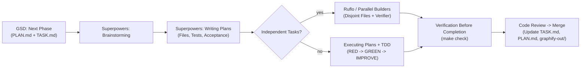

# Planning — `multi-agent-conversational-orchestration` (`ma_co`)

How work is planned and verified in this repository.

| What | Where |
|---|---|
| Design rationale, layered contracts, phase status | [PLAN.md](PLAN.md), [docs/ARCHITECTURE.md](docs/ARCHITECTURE.md), [docs/adr/](docs/adr/) |
| Live backlog (done / next) | [TASK.md](TASK.md) |
| Agent rules & repeatable procedures | [AGENTS.md](AGENTS.md), `.agents/rules/`, `.agents/skills/` |
| Structural dependency map | [graphify-out/GRAPH_REPORT.md](graphify-out/GRAPH_REPORT.md) |

## Workflow: GSD → Superpowers → Ruflo

Every non-trivial change (new agent, tool, contract change, security guardrail, or eval tier) goes through three layers. Trivial one-line fixes with a test skip directly to execution.

| Layer | Tool | Owns | Output |
|---|---|---|---|
| **Roadmap** | **GSD** (Get Shit Done) | Milestones and phases | `TASK.md` + `PLAN.md` phase table |
| **Task Plan** | **Superpowers** | Design and step-by-step plan for one phase | `brainstorming` → `writing-plans` |
| **Execution** | **Ruflo** / TDD | Parallel disjoint builders or sequential TDD (`RED → GREEN → IMPROVE`) | Verified commits + `make check` |

## Rules for Every Plan

1. Every step names explicit files, tests, and the acceptance command (`make check`).
2. Thresholds, policy caps, validation vetoes, and prompt-injection framing live in pure Python under `src/ma_co/contracts/` and `src/ma_co/core/` — never in prompts.
3. All default tests and evaluations run 100% offline with branch coverage enabled (`branch = true`, `>=80%` floor) and zero skipped offline tests.
4. Live provider runs (`BYNARA_API_KEY`, `GOOGLE_API_KEY`) spend tokens: get explicit approval first and isolate them behind `@pytest.mark.live`.
5. Refresh `graphify-out/` locally after module additions or phase merges so agents and reviewers share an up-to-date dependency map.
