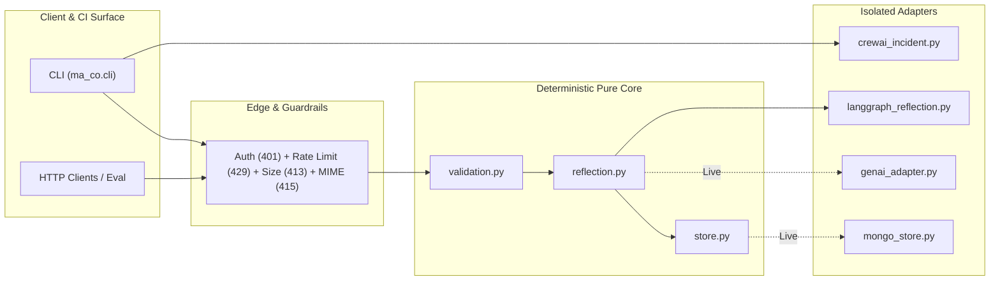
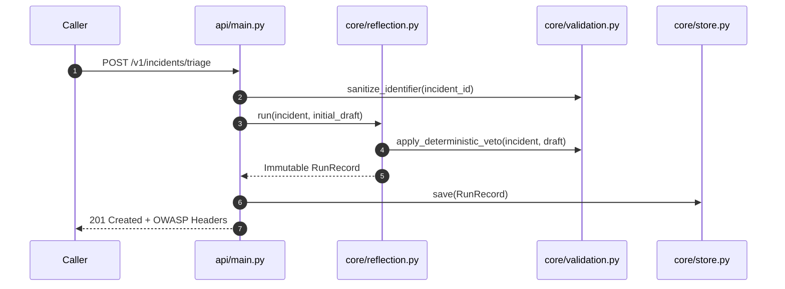

# Architecture & Planning (`ma_co`)

## Design Principles

1. **Deterministic Core vs. AI Layering**: Policy caps (`max_regenerations`, `max_estimated_cost_usd`, `forbidden_tools`), draft validation (`validate_incident_draft`), identifier sanitization (`sanitize_identifier`), and prompt-injection framing (`frame_untrusted_text`) live in pure Python functions under `src/ma_co/core/`.
2. **Immutability**: All Pydantic DTOs in `src/ma_co/core/models.py` use `ConfigDict(frozen=True)`. State transitions in `ReflectionEngine` and `/v1/runs/{run_id}/review` construct new records via `model_copy(update=...)`.
3. **Read-Only Triage Boundary**: Neither CrewAI agents nor the FastAPI `/review` endpoint can trigger rollbacks, deployments, or external notifications.
4. **Offline-First Verification**: All unit, integration, security, and evaluation tests run 100% offline (`CREWAI_MOCK=1` and `FixtureJudge`/`FixtureRegenerator`), while live provider tests are isolated behind `@pytest.mark.live`.

## Layered Architecture (`flowchart LR`)

## Runtime Sequence (`sequenceDiagram`)

## References

- [docs/ARCHITECTURE.md](docs/ARCHITECTURE.md) — Component contracts and tool schemas
- [docs/DECISIONS.md](docs/DECISIONS.md) — CrewAI and LangGraph orchestration rationale
- [docs/PLAN.md](docs/PLAN.md) — Four-week implementation milestones
