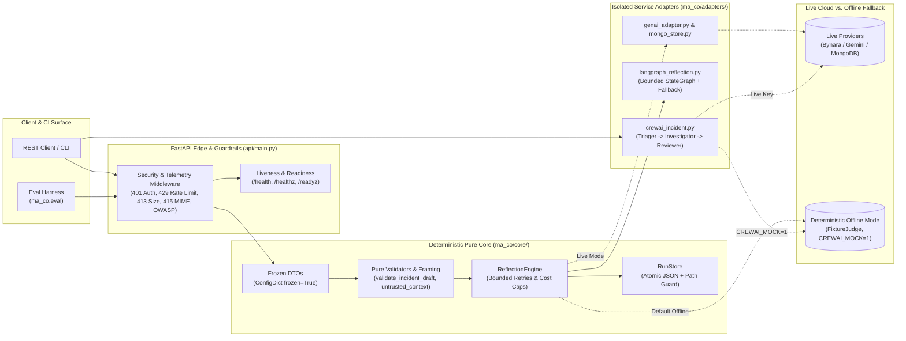

# Multi-Agent Conversational Orchestration (`ma_co`)

[](https://github.com/AshraHossain/multi-agent-conversational-orchestration/actions)


An enterprise incident-response orchestration service that combines a read-only three-agent **CrewAI** crew (`Triager -> Investigator -> Safety Reviewer`), a bounded **LangGraph** reflection state machine, and a deterministic **SRAF-style policy & quality gate engine** behind a hardened **FastAPI** API. All default runs execute 100% offline with deterministic fixtures (`CREWAI_MOCK=1`), immutable Pydantic contracts, and strict human-in-the-loop approval boundaries — agents never execute live rollbacks, deployments, or emails.

---

## System Architecture & Request Flow

### 1. Layered System Architecture



### 2. End-to-End Request Sequence

```mermaid
sequenceDiagram
    autonumber
    participant Client
    participant API as FastAPI Edge (main.py)
    participant Core as ReflectionEngine + Validators
    participant Graph as LangGraph / FixtureJudge
    participant Store as RunStore (JSON / Mongo)

    rect rgb(240, 248, 255)
    Note over Client,Store: Incident Triage Flow (POST /v1/incidents/triage)
    Client->>API: POST /v1/incidents/triage (IncidentInput JSON)
    API->>API: Verify Auth (401), Rate Limit (429), MIME (415), Size (413), ID (400)
    API->>Core: engine.run(incident, initial_draft)
    loop Up to policy.max_regenerations
        Core->>Graph: judge.evaluate(incident, draft)
        Core->>Core: apply_deterministic_veto(validate_incident_draft)
        alt Score >= min_score and no defects
            Core-->>API: Status (needs_review or approved_draft)
        else Retry budget remaining
            Core->>Graph: regenerator.regenerate(incident, draft, critique)
        end
    end
    API->>Store: save(immutable RunRecord)
    API-->>Client: 201 Created (RunRecord) + X-Request-ID & OWASP Headers
    end

    rect rgb(245, 255, 245)
    Note over Client,Store: Human Decision Recording (POST /v1/runs/{run_id}/review)
    Client->>API: POST /v1/runs/{run_id}/review (ApprovalInput)
    API->>Store: get(run_id)
    API->>API: Validate Status.NEEDS_REVIEW (else 409)
    API->>Store: save(record.model_copy(update=decision))
    API-->>Client: 200 OK (Decision recorded; zero external execution)
    end
```

---

## Quickstart

Dependency management is [UV](https://docs.astral.sh/uv/)-based:

```bash
make setup                           # uv sync --group dev
make check                           # ruff lint + pytest (>=80% cov gate) + eval harness
make dev                             # uv run uvicorn ma_co.api.main:app --reload
```

### CLI & Smoke Test (`curl`)

```bash
# Offline CLI triage flow
uv run python -m ma_co.cli

# 3-agent CrewAI adapter with offline deterministic mock
CREWAI_MOCK=1 uv run python -m ma_co.cli --live-crewai

# API smoke test (with server running)
curl -s http://127.0.0.1:8000/readyz
curl -s -X POST http://127.0.0.1:8000/v1/incidents/triage \
  -H "Content-Type: application/json" \
  -d '{"incident_id":"INC-001","alert":"Elevated 5xx errors","evidence":["Prometheus 5xx rate 12%"],"proposed_action":"Review rollback"}'
```

---

## Evaluation & Benchmark Scorecard (`make eval`)

Run `uv run python -m ma_co.eval` to execute the deterministic golden benchmark and write [evaluation/eval_report.json](evaluation/eval_report.json):

| Case ID | Status OK | Grounded | Iterations | Latency (ms) |
|---|---|---|---|---|
| `EVAL-01-HIGH-5XX` | `True` | `True` | 2 | 32.35 |
| `EVAL-02-NO-ACTION-APPROVED` | `True` | `True` | 2 | 2.13 |
| `EVAL-03-MISSING-EVIDENCE` | `True` | `True` | 3 | 2.52 |

- **Recall@1 / Policy Accuracy**: `100.0%`
- **Evidence Grounding Rate**: `100.0%`
- **Security Guardrail Pass Rate (`415` / `400` / `<untrusted_context>` framing)**: `100.0%`
- **Latency (`p50` / `p95`)**: `2.52 ms` / `32.35 ms`

---

## Security Controls & Explicit Limits

- **Defense-in-Depth**: Timing-safe `API_AUTH_TOKEN` verification (`401`), sliding-window rate limiting (`429`), `1 MB` payload cap (`413`), `application/json` MIME enforcement (`415`), path-traversal rejection (`400`), `<untrusted_context>` prompt-injection framing, OWASP headers, Ruff Bandit (`S`) linting, and non-root Docker execution (`UID 10001`). See [SECURITY.md](SECURITY.md).
- **Explicit Limits**:
  - `/v1/runs/{run_id}/review` is a **decision recorder**, not an execution engine; production remediation belongs in a separate authenticated executor service.
  - Default fixture scores (`FixtureJudge`) are deterministic and synthetic; enable `GenaiJudge` (`GOOGLE_API_KEY`) or `run_crew` (`BYNARA_API_KEY`) for live model evaluation.

## Documentation & Governance

- [AGENTS.md](AGENTS.md) & [GEMINI.md](GEMINI.md) — Agent instructions, scoped rules (`.agents/rules/`), and skills (`.agents/skills/`)
- [PLANNING.md](PLANNING.md) & [docs/ARCHITECTURE.md](docs/ARCHITECTURE.md) — Detailed architecture, contracts, and design decisions
- [SECURITY.md](SECURITY.md) — Threat model and security mitigations
- [CONTRIBUTING.md](CONTRIBUTING.md) & [CHANGELOG.md](CHANGELOG.md) — Contribution workflow and release history
