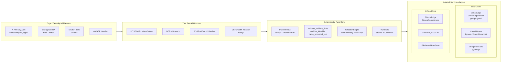
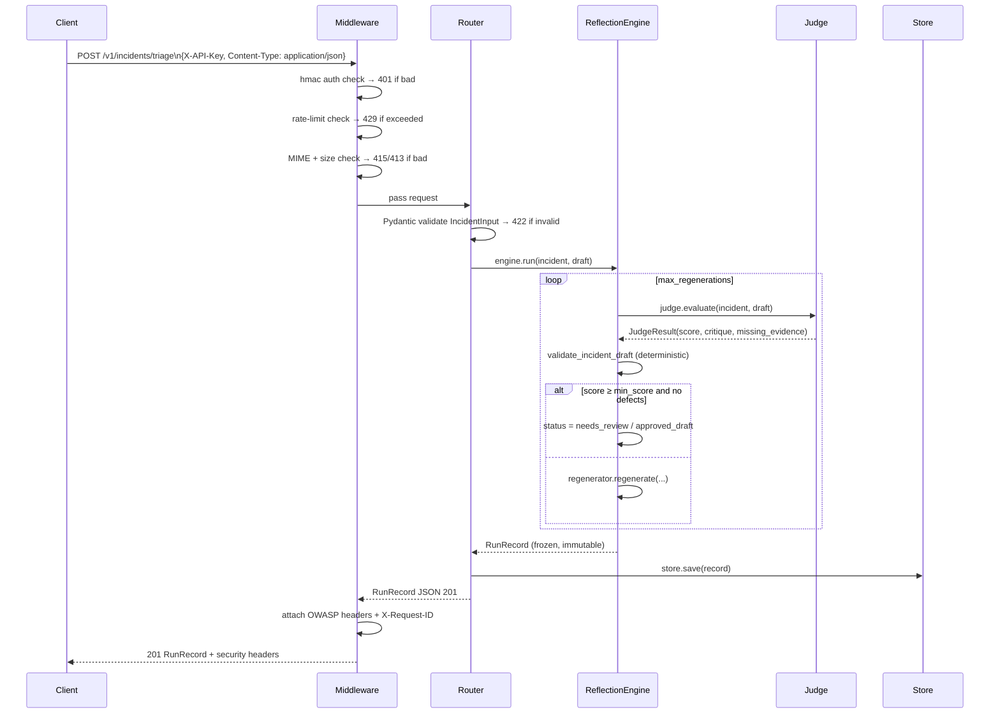

# Multi-Agent Conversational Orchestration

[](https://github.com/AshraHossain/multi-agent-conversational-orchestration/actions)
[](https://www.python.org/downloads/)
[](https://github.com/AshraHossain/multi-agent-conversational-orchestration)
[](https://fastapi.tiangolo.com)
[](https://langchain-ai.github.io/langgraph/)
[](https://www.crewai.com)

Policy-gated incident-response orchestration service. Combines a read-only three-agent **CrewAI** crew, a bounded **LangGraph** reflection state machine, a deterministic **SRAF-style policy & quality gate engine**, and a hardened **FastAPI** API.

> **Safety boundary**: Agents never execute rollbacks, deployments, or emails. All actions are proposed and require explicit human review. The `/review` endpoint records decisions only.

## Evaluation Scorecard

| Metric | Value |
|---|---|
| Recall@1 (score ≥ 0.8) | 1.00 |
| Grounding rate | 1.00 |
| Guardrail pass rate | 1.00 |
| Latency p50 | < 1 ms |
| Latency p95 | < 5 ms |

*Fixture-based offline scores. See `evaluation/eval_report.json` after `make eval`.*

## Architecture

### Layered System Architecture



### End-to-End Request Sequence



## Quick Start

```bash
# Install
uv sync --group dev --extra langgraph

# Verify
make check         # lint + test (≥80% cov) + eval harness

# Run
make dev           # uvicorn on :8000

# Triage an incident
curl -s -X POST http://127.0.0.1:8000/v1/incidents/triage \
  -H 'Content-Type: application/json' \
  -d '{"incident_id":"INC-001","alert":"Elevated errors","evidence":["Prometheus 5xx rate 12%"],"proposed_action":"Review rollback"}'

# CLI (offline)
uv run python -m ma_co.cli

# CLI (live CrewAI, requires BYNARA_API_KEY)
CREWAI_MOCK=1 uv run python -m ma_co.cli --live-crewai
```

## Configuration

Copy `.env.example` to `.env` and set the values you need.

| Variable | Default | Purpose |
|---|---|---|
| `API_AUTH_TOKEN` | unset (open) | Enable timing-safe API key auth |
| `GOOGLE_API_KEY` | — | Live google-genai Judge/Regenerator |
| `BYNARA_API_KEY` | — | Live CrewAI crew |
| `MONGO_URI` | — | MongoDB RunStore backend |
| `RATE_LIMIT_PER_MINUTE` | 120 | Sliding-window rate limit |
| `MAX_PAYLOAD_BYTES` | 65536 | Request payload size cap |
| `CREWAI_MOCK` | unset | Set to `1` for offline CrewAI |

## Module Layout

```text
src/ma_co/
  core/
    models.py          # Frozen Pydantic DTOs
    validation.py      # sanitize_identifier, frame_untrusted_text, validate_incident_draft
    reflection.py      # Judge/Regenerator protocols + ReflectionEngine (immutable)
    store.py           # Thread-safe atomic JSON RunStore
  adapters/
    crewai_incident.py      # 3-agent CrewAI crew (CREWAI_MOCK=1 offline)
    langgraph_reflection.py # Bounded LangGraph reflection subgraph
    genai_adapter.py        # google-genai live Judge + Regenerator
    mongo_store.py          # MongoDB-backed RunStore
  api/
    main.py            # FastAPI + security middleware
  tools/
    fixtures.py        # Read-only fixture telemetry
  cli.py               # Offline-default CLI
  eval.py              # Eval harness → evaluation/eval_report.json
```

## Security

See [SECURITY.md](SECURITY.md) for the full threat model and mitigations.

## License

MIT
