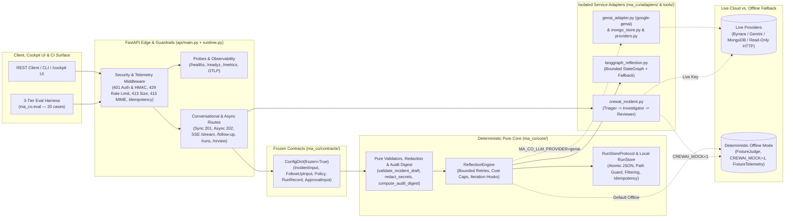
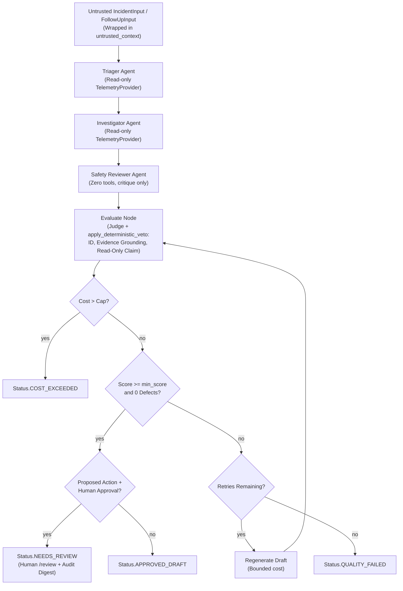

# Multi-Agent Conversational Orchestration (`ma_co`)

[](https://github.com/AshraHossain/multi-agent-conversational-orchestration/actions)


An enterprise incident-response orchestration service (`v0.3.0`) combining a read-only three-agent **CrewAI** crew (`Triager -> Investigator -> Safety Reviewer`), a bounded **LangGraph** reflection state machine, a deterministic **policy & quality gate engine**, **idempotent & async `202` intake**, **SSE streaming**, **conversational follow-ups**, **Prometheus/OTLP observability**, and an offline **Incident Cockpit UI** (`/cockpit`) behind a hardened **FastAPI** API. All default runs execute 100% offline with framework-free frozen `contracts/`, pure deterministic `core/`, strict `mypy` across all layers including adapters, AST-enforced layering invariants, and a 20-case 3-tier evaluation & red-team harness — agents never execute live rollbacks, deployments, or emails.

---

## System Architecture & Request Flow

### 1. Layered System Architecture



### 2. Multi-Agent & Bounded Reflection Orchestration



### 3. End-to-End Request Sequence

```mermaid
sequenceDiagram
    autonumber
    participant Client
    participant API as FastAPI Edge (main.py)
    participant Core as ReflectionEngine + Validators
    participant Store as RunStore / MongoRunStore

    rect rgb(240, 248, 255)
    Note over Client,Store: Sync (201) or Async (202) Incident Triage + SSE Stream
    Client->>API: POST /v1/incidents/triage[/async] (IncidentInput + Idempotency-Key)
    API->>API: Auth/HMAC (401), Rate Limit (429), MIME (415), Size (413), Idempotency (200/409)
    API->>Core: execute_triage(incident, use_crewai)
    loop Up to policy.max_regenerations
        Core->>Core: judge.evaluate + apply_deterministic_veto
        Core-->>Store: on_iteration snapshot (for SSE /stream)
    end
    Core->>Core: compute_audit_digest(record)
    API->>Store: save(immutable RunRecord)
    API-->>Client: 201 Created / 202 Accepted (RunRecord) + OWASP & Telemetry Headers
    Client->>API: GET /v1/runs/{run_id}/stream (SSE)
    API-->>Client: event: iteration ... event: complete
    end

    rect rgb(245, 255, 245)
    Note over Client,Store: Conversational Follow-Up & Human Review Decision
    Client->>API: POST /v1/runs/{run_id}/follow-up (FollowUpInput)
    API->>Store: save(immutable child RunRecord with parent_run_id)
    API-->>Client: 201 Created (child RunRecord)
    Client->>API: POST /v1/runs/{run_id}/review (ApprovalInput + audit note)
    API->>Store: save(record with chained audit_digest; zero external execution)
    API-->>Client: 200 OK (Decision recorded)
    end
```

---

## Quickstart

Dependency management is [UV](https://docs.astral.sh/uv/)-based:

```bash
make setup                           # uv sync --group dev
make check                           # ruff check/format + strict mypy + pytest (branch cov >=80%) + 3-tier eval
make dev                             # uv run uvicorn ma_co.api.main:app --reload
```

Open **`http://127.0.0.1:8000/cockpit`** while running `make dev` to use the interactive **Incident Cockpit UI** (submit sync/async incidents, watch live SSE streams, inspect deterministic vetoes & draft diffs, submit conversational follow-ups, and approve/reject pending runs).

### CLI, API & Eval Smoke Tests

```bash
# Offline CLI triage flow
uv run python -m ma_co.cli

# 3-agent CrewAI adapter with offline deterministic mock
CREWAI_MOCK=1 uv run python -m ma_co.cli --live-crewai

# 3-tier evaluation & red-team matrix (20 cases x 3 repetitions, isolated store)
uv run python -m ma_co.eval --guardrails --verifier-matrix --repeat 3

# API smoke tests (with server running)
curl -s http://127.0.0.1:8000/readyz
curl -s http://127.0.0.1:8000/metrics | head -n 10
curl -s -X POST http://127.0.0.1:8000/v1/incidents/triage \
  -H "Content-Type: application/json" \
  -H "Idempotency-Key: demo-1" \
  -d '{"incident_id":"INC-001","alert":"Elevated 5xx errors","evidence":["Prometheus 5xx rate 12%"],"proposed_action":"Review rollback"}'
```

---

## 3-Tier Evaluation & Red-Team Scorecard (`make eval`)

Run `uv run python -m ma_co.eval --guardrails --verifier-matrix --repeat 3` to execute the 20-case versioned golden benchmark ([evaluation/datasets/golden_cases.jsonl](evaluation/datasets/golden_cases.jsonl), `main` + `heldout` splits), 12 guardrail perturbations, and the deterministic verifier red-team matrix ([evaluation/eval_report.json](evaluation/eval_report.json)):

- **Tier 1 — Policy Accuracy & Grounding (`20 cases x 3 passes`)**: `100.0%` Policy Accuracy (`stdev: 0.0`), `100.0%` Evidence Grounding, **12/12** security & policy guardrail perturbations blocked (`401` auth + HMAC webhook signing, `409` idempotency conflict, `413` size, `415` MIME, `429` rate limit, `400` path traversal, `<untrusted_context>` escape, forbidden tool, spoofed ID, evidence denial).
- **Tier 2 — Verifier Red-Team Matrix (`--verifier-matrix`)**: **92/92** planted defects caught (`100.0%`) across `missing_incident_id`, `spoofed_incident_id`, `evidence_contradiction`, `readonly_execution_claim`, and `fabricated_evidence`, with **0/20** false positives on clean drafts.
- **Tier 3 — Opt-In Live Semantic Replay (`--live`)**: Documented deterministic blind spots (`paraphrased_certainty`, `subtle_causal_overclaim`) can be replayed against live `GenaiJudge` when `GOOGLE_API_KEY` is explicitly provided.
- **Latency (`p50` / `p95`, offline mock)**: `1.42 ms` / `2.44 ms`.

---

## Security Controls & Explicit Limits

- **Defense-in-Depth**: Timing-safe `API_AUTH_TOKEN` verification (`401`), optional `WEBHOOK_SIGNING_SECRET` HMAC-SHA256 verification with replay window (`401`), `Idempotency-Key` replay/conflict enforcement (`200`/`409`), sliding-window rate limiting with bounded stale-key eviction (`429`), `1 MB` payload cap (`413`), `application/json` MIME enforcement (`415`), path-traversal rejection (`400`), `<untrusted_context>` prompt-injection framing, secret/PII log redaction (`redact_secrets`), SHA-256 `audit_digest` chaining, OWASP headers (with route-scoped CSP for `/cockpit`), strict `mypy` across all 25 source files, Ruff Bandit (`S`) + `SIM`/`RUF` linting, AST layering invariant tests, and non-root Docker execution (`UID 10001`). See [SECURITY.md](SECURITY.md).
- **Explicit Limits**:
  - `/v1/runs/{run_id}/review` is a **decision recorder**, not an execution engine; production remediation belongs in a separate authenticated executor service.
  - Default fixture scores (`FixtureJudge`) are deterministic and synthetic; enable `MA_CO_LLM_PROVIDER=genai` (`GOOGLE_API_KEY`) or `MA_CO_USE_CREWAI=1` (`BYNARA_API_KEY`) for live model evaluation.

## Documentation & Governance

- [AGENTS.md](AGENTS.md), [GEMINI.md](GEMINI.md) & [CLAUDE.md](CLAUDE.md) — Agent instructions, scoped rules (`.agents/rules/`), and skills (`.agents/skills/`)
- [PLANNING.md](PLANNING.md), [PLAN.md](PLAN.md), [TASK.md](TASK.md) & [docs/adr/](docs/adr/) — GSD → Superpowers → Ruflo planning workflow, roadmap, backlog, and ADRs (`0001`–`0004`)
- [docs/ARCHITECTURE.md](docs/ARCHITECTURE.md) & [graphify-out/GRAPH_REPORT.md](graphify-out/GRAPH_REPORT.md) — Component contracts and structural knowledge graph
- [SECURITY.md](SECURITY.md), [CONTRIBUTING.md](CONTRIBUTING.md) & [CHANGELOG.md](CHANGELOG.md) — Threat model, TDD workflow, and release history
