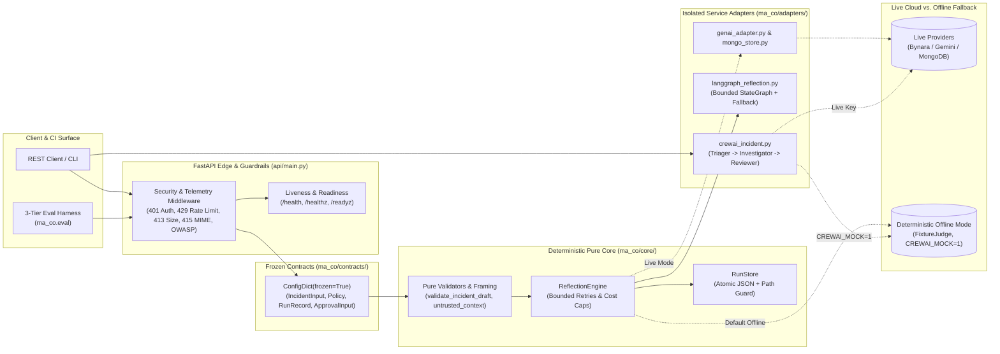
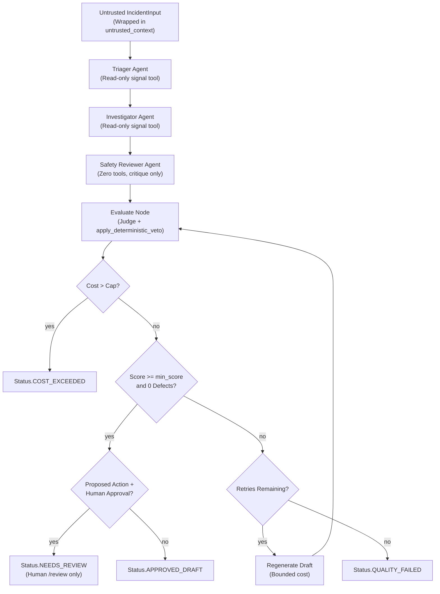

# Multi-Agent Conversational Orchestration (`ma_co`)

[](https://github.com/AshraHossain/multi-agent-conversational-orchestration/actions)


An enterprise incident-response orchestration service that combines a read-only three-agent **CrewAI** crew (`Triager -> Investigator -> Safety Reviewer`), a bounded **LangGraph** reflection state machine, and a deterministic **SRAF-style policy & quality gate engine** behind a hardened **FastAPI** API. All default runs execute 100% offline with framework-free frozen `contracts/`, pure deterministic `core/`, AST-enforced layering invariants, and a 3-tier evaluation & red-team harness — agents never execute live rollbacks, deployments, or emails.

---

## System Architecture & Request Flow

### 1. Layered System Architecture



### 2. Multi-Agent & Bounded Reflection Orchestration



### 3. End-to-End Request Sequence

```mermaid
sequenceDiagram
    autonumber
    participant Client
    participant API as FastAPI Edge (main.py)
    participant Core as ReflectionEngine + Validators
    participant Graph as LangGraph / FixtureJudge
    participant Store as RunStore (JSON / Mongo)

    rect rgb(240, 248, 255)
    Note over Client,Store: Incident Triage Flow (POST /v1/incidents/triage)
    Client->>API: POST /v1/incidents/triage (IncidentInput JSON)
    API->>API: Verify Auth (401), Rate Limit (429), MIME (415), Size (413), ID (400)
    API->>Core: engine.run(incident, initial_draft)
    loop Up to policy.max_regenerations
        Core->>Graph: judge.evaluate(incident, draft)
        Core->>Core: apply_deterministic_veto(validate_incident_draft)
        alt Score >= min_score and no defects
            Core-->>API: Status (needs_review or approved_draft)
        else Retry budget remaining
            Core->>Graph: regenerator.regenerate(incident, draft, critique)
        end
    end
    API->>Store: save(immutable RunRecord)
    API-->>Client: 201 Created (RunRecord) + X-Request-ID & OWASP Headers
    end

    rect rgb(245, 255, 245)
    Note over Client,Store: Human Decision Recording (POST /v1/runs/{run_id}/review)
    Client->>API: POST /v1/runs/{run_id}/review (ApprovalInput)
    API->>Store: get(run_id)
    API->>API: Validate Status.NEEDS_REVIEW (else 409)
    API->>Store: save(record.model_copy(update=decision))
    API-->>Client: 200 OK (Decision recorded; zero external execution)
    end
```

---

## Quickstart

Dependency management is [UV](https://docs.astral.sh/uv/)-based:

```bash
make setup                           # uv sync --group dev
make check                           # ruff check/format + mypy + pytest (branch cov >=80%) + 3-tier eval
make dev                             # uv run uvicorn ma_co.api.main:app --reload
```

### CLI & Smoke Test (`curl`)

```bash
# Offline CLI triage flow
uv run python -m ma_co.cli

# 3-agent CrewAI adapter with offline deterministic mock
CREWAI_MOCK=1 uv run python -m ma_co.cli --live-crewai

# 3-tier evaluation & red-team matrix (3 repetitions)
uv run python -m ma_co.eval --guardrails --verifier-matrix --repeat 3

# API smoke test (with server running)
curl -s http://127.0.0.1:8000/readyz
curl -s -X POST http://127.0.0.1:8000/v1/incidents/triage \
  -H "Content-Type: application/json" \
  -d '{"incident_id":"INC-001","alert":"Elevated 5xx errors","evidence":["Prometheus 5xx rate 12%"],"proposed_action":"Review rollback"}'
```

---

## 3-Tier Evaluation & Red-Team Scorecard (`make eval`)

Run `uv run python -m ma_co.eval --guardrails --verifier-matrix --repeat 3` to execute the offline golden benchmark (`main` + `heldout` splits), 10 guardrail perturbations, and the deterministic verifier red-team matrix ([evaluation/eval_report.json](evaluation/eval_report.json)):

| Case ID | Split | Status OK | Grounded | Compliance (`--repeat 3`) | Iterations |
|---|---|---|---|---|---|
| `EVAL-01-HIGH-5XX` | `main` | `True` | `True` | `3/3` | 2 |
| `EVAL-02-NO-ACTION-APPROVED` | `main` | `True` | `True` | `3/3` | 2 |
| `EVAL-03-MISSING-EVIDENCE` | `main` | `True` | `True` | `3/3` | 3 |
| `EVAL-04-HELDOUT-DB-POOL` | `heldout` | `True` | `True` | `3/3` | 2 |
| `EVAL-05-HELDOUT-OBSERVATION-ONLY` | `heldout` | `True` | `True` | `3/3` | 2 |

- **Tier 1 — Policy Accuracy & Grounding (`--repeat 3`)**: `100.0%` (`stdev: 0.0`), **10/10** security & policy guardrail perturbations blocked (`401`, `413`, `415`, `429`, `400`, `<untrusted_context>` escape, forbidden tool, spoofed ID, evidence denial).
- **Tier 2 — Verifier Red-Team Matrix (`--verifier-matrix`)**: **14/14** planted defects caught (`100.0%`), **0/5** false positives on clean drafts. Known deterministic blind spots (`paraphrased_certainty`, `subtle_causal_overclaim`) are documented for live semantic review.
- **Latency (`p50` / `p95`, offline mock)**: `1.39 ms` / `6.84 ms`.

---

## Security Controls & Explicit Limits

- **Defense-in-Depth**: Timing-safe `API_AUTH_TOKEN` verification (`401`), sliding-window rate limiting (`429`), `1 MB` payload cap (`413`), `application/json` MIME enforcement (`415`), path-traversal rejection (`400`), `<untrusted_context>` prompt-injection framing, OWASP headers, Ruff Bandit (`S`) + `SIM`/`RUF` linting, AST layering invariant tests, and non-root Docker execution (`UID 10001`). See [SECURITY.md](SECURITY.md).
- **Explicit Limits**:
  - `/v1/runs/{run_id}/review` is a **decision recorder**, not an execution engine; production remediation belongs in a separate authenticated executor service.
  - Default fixture scores (`FixtureJudge`) are deterministic and synthetic; enable `GenaiJudge` (`GOOGLE_API_KEY`) or `run_crew` (`BYNARA_API_KEY`) for live model evaluation.

## Documentation & Governance

- [AGENTS.md](AGENTS.md), [GEMINI.md](GEMINI.md) & [CLAUDE.md](CLAUDE.md) — Agent instructions, scoped rules (`.agents/rules/`), and skills (`.agents/skills/`)
- [PLANNING.md](PLANNING.md), [PLAN.md](PLAN.md), [TASK.md](TASK.md) & [docs/adr/](docs/adr/) — GSD → Superpowers → Ruflo planning workflow, roadmap, backlog, and ADRs
- [docs/ARCHITECTURE.md](docs/ARCHITECTURE.md) & [graphify-out/GRAPH_REPORT.md](graphify-out/GRAPH_REPORT.md) — Component contracts and structural knowledge graph
- [SECURITY.md](SECURITY.md), [CONTRIBUTING.md](CONTRIBUTING.md) & [CHANGELOG.md](CHANGELOG.md) — Threat model, TDD workflow, and release history
