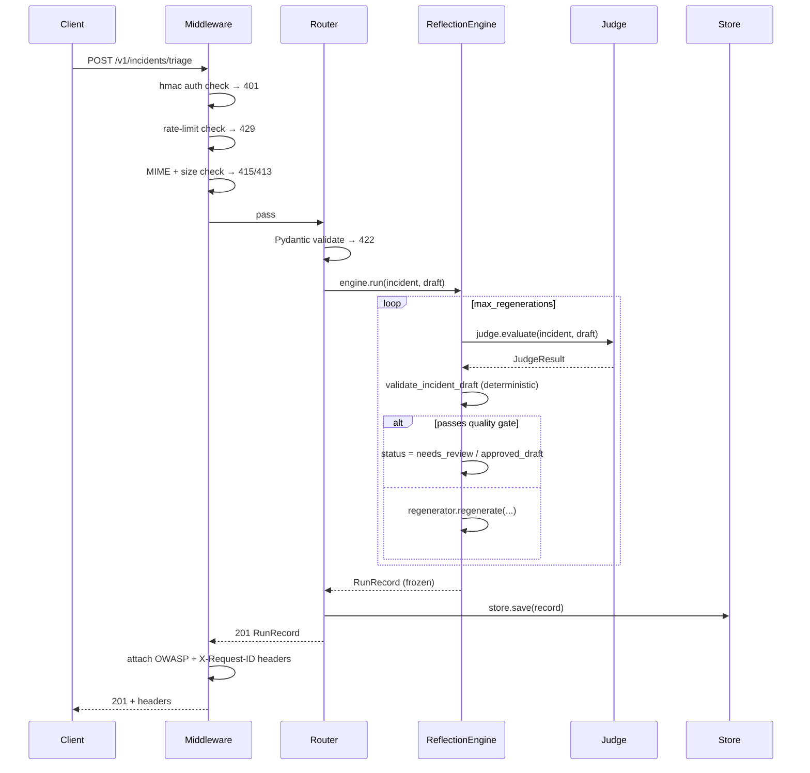

# Architecture and Component Contracts

## Layered System Architecture

```mermaid
flowchart LR
    subgraph Edge["Edge / Security Middleware"]
        A[X-API-Key Auth\nhmac.compare_digest]
        B[Sliding-Window\nRate Limiter]
        C[MIME + Size Guards]
        D[OWASP Headers]
    end

    subgraph Router["Thin FastAPI Routers"]
        E[POST /v1/incidents/triage]
        F[GET /v1/runs/:id]
        G[POST /v1/runs/:id/review]
        H[Probe endpoints\n/health /healthz /readyz]
    end

    subgraph Core["Deterministic Pure Core"]
        I[Frozen DTOs\nIncidentInput · Policy · RunRecord]
        J[validate_incident_draft\nsanitize_identifier\nframe_untrusted_text]
        K[ReflectionEngine\nbounded retry + cost cap]
        L[RunStore\natomic JSON writes]
    end

    subgraph Adapters["Isolated Service Adapters"]
        subgraph Live["Live Cloud"]
            M[GenaiJudge / GenaiRegenerator\ngoogle-generativeai]
            N[CrewAI Crew\nBynara / OpenAI-compat]
            O[MongoRunStore — pymongo]
        end
        subgraph Offline["Offline Mock / Fixture"]
            P[FixtureJudge / FixtureRegenerator]
            Q[CREWAI_MOCK=1 offline branch]
            R[File-based RunStore]
        end
    end

    Edge --> Router
    Router --> Core
    Core --> Adapters
```

## End-to-End Request Sequence

## Component Boundaries

| Component | Input | Output | Failure handling |
|---|---|---|---|
| Security middleware | HTTP request | Pass / 401 / 413 / 415 / 429 | Fail closed |
| API router | IncidentInput | RunRecord + run_id | Reject invalid inputs; fail closed |
| ReflectionEngine | IncidentInput + draft | RunRecord (frozen) | Hard cap on retries and budget |
| FixtureJudge | IncidentInput + draft | JudgeResult | Deterministic, never raises |
| validate_incident_draft | IncidentInput + draft | list[str] defects | Pure function |
| frame_untrusted_text | str | str wrapped in XML | Pure function |
| sanitize_identifier | str | safe str | Pure function |
| RunStore | RunRecord | None / RunRecord | Atomic write; raises on bad ID |
| Approval recorder | run_id + decision | Updated RunRecord | No external execution |

## API

| Method | Route | Status codes | Purpose |
|---|---|---|---|
| GET | /health, /healthz, /readyz | 200 | Probe (bypasses auth) |
| POST | /v1/incidents/triage | 201, 400, 401, 413, 415, 422, 429 | Create bounded run |
| GET | /v1/runs/{run_id} | 200, 400, 401, 404, 429 | Read run history |
| POST | /v1/runs/{run_id}/review | 200, 400, 401, 404, 409, 429 | Record demo approval/rejection |

## Tool Contracts

`lookup_event(incident_id, source)` is read-only fixture access. `source` must be one of `prometheus`, `github`, `kubernetes`. Never grant a reviewer an execution tool.

## Invariants

1. **Read-Only Triage**: Agents never execute live actions; `/review` records decisions only.
2. **Fixture-Default**: Zero live network calls unless `--live-crewai` or `GOOGLE_API_KEY` explicitly set.
3. **Deterministic Core**: Quality gates, cost caps, and validation live in pure Python — never in prompts.
4. **Immutability**: All DTOs are `ConfigDict(frozen=True)`; state transitions use `model_copy(update=...)`.
5. **Prompt-Injection Safety**: All untrusted input wrapped in `<untrusted_context>` before reaching adapters.
